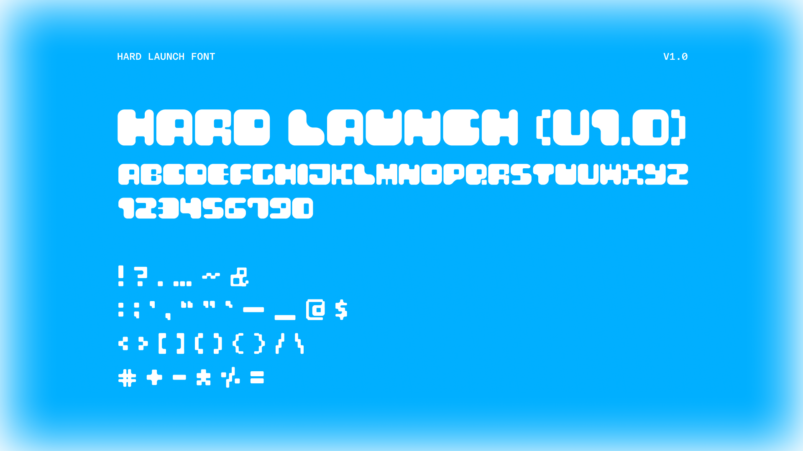

# Hardlaunch

Hardlaunch is a loud, chunky display typeface for big announcements. Its blocky letters have soft, rounded
corners, so it hits hard without feeling harsh, with a little late-90s Japanese magazine and retro game energy
in every shape.

It's built for headlines, logos and anything that needs to land at a glance. It's a single all-caps weight with
deep, punchy counters and tight, even spacing, so a few words fill the space with confidence.

<br>



## Download

Grab the files from `fonts/`:

| File | Use it for |
|---|---|
| `fonts/Hardlaunch-Regular.otf` | Installing on your computer: open it, then click **Install** |
| `fonts/Hardlaunch-Regular.woff2` | Websites |

If an older version of Hardlaunch is installed, remove it in Font Book first, or choose to replace it when you
install.

## Web

Host the WOFF2 yourself:

```css
@font-face {
  font-family: "Hardlaunch";
  src: url("Hardlaunch-Regular.woff2") format("woff2");
  font-weight: 400;
  font-style: normal;
  font-display: swap;
}

h1 {
  font-family: "Hardlaunch", system-ui, sans-serif;
}
```

- **Caps only:** lowercase letters use the capital shapes, so `text-transform` isn't needed. Type normally.
- **Size:** it's a display face. It looks best at 24px and up.
- **Line height:** the capitals are tall for their em (cap height 0.695 em), so a `line-height` of about 1.1 to 1.2
  keeps stacked headlines tight without lines touching.

## Character set

| Group | Characters |
|---|---|
| Letters | `A`–`Z` (lowercase `a`–`z` use the same shapes) |
| Figures | `0`–`9` |
| Punctuation | ``. , : ; ! ? ' " “ ” ` ( ) [ ] { } / \ - — _`` |
| Symbols | `+ = < > * & @ # $ % ^ ~` |

Some related characters borrow a glyph: ‘ ’ use `'`, ‚ uses `,`, the en dash and minus sign use `-`, ‹ › use
`<` `>`, and ― uses `—`. Any other Latin letter or punctuation mark shows a period for now, until it gets its own
design.

## Metrics

| Metric | Units | Notes |
|---|---|---|
| Units per em | 1000 | |
| Cap height | 695 | Also the x-height, since every letter is a capital |
| Ascender / descender | 800 / −200 | |
| Side bearings | 45 | On each side of every glyph, for even spacing |

## Build

Python 3.9 or newer:

```sh
python3 -m venv .venv
.venv/bin/python -m pip install -r requirements.txt
.venv/bin/python source/build.py
```

Writes `fonts/Hardlaunch-Regular.otf` and `fonts/Hardlaunch-Regular.woff2`.

## Sources

The outlines are stored as SVG path data in two files:

- `source/glyphs.py`: letters, figures and the period
- `source/glyphs_special.py`: punctuation and symbols, plus the code points each one covers in `UNI`

Every glyph is drawn on a 347 × 347 grid, with the bottom edge on the baseline, and scaled by 2 into font units.
`build.py` merges overlapping shapes, adds the side bearings and writes the character map.

To add a glyph, paste its path into `glyphs_special.py`, list its code points in `UNI` and rebuild. Any code point
it takes over stops falling back to the period.
